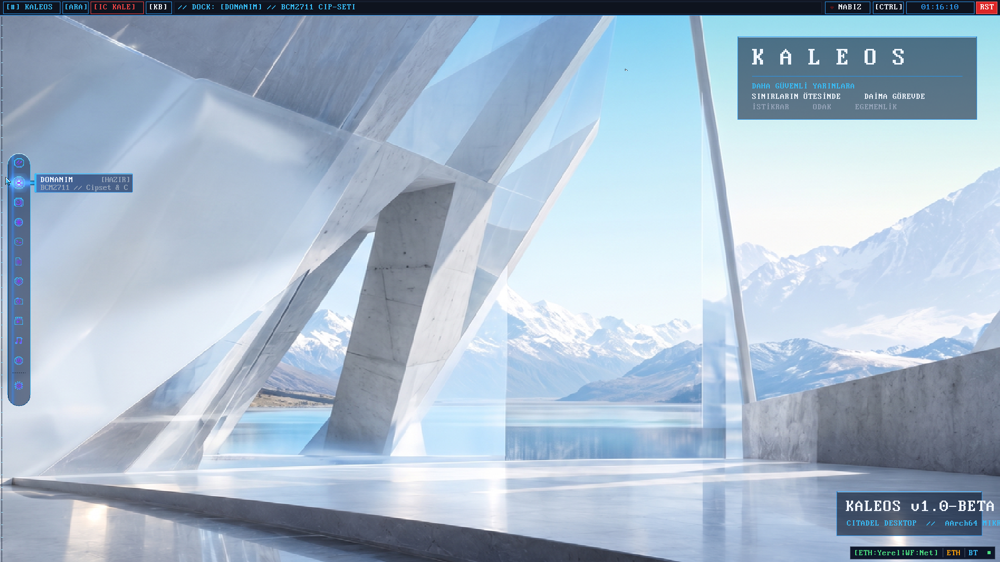
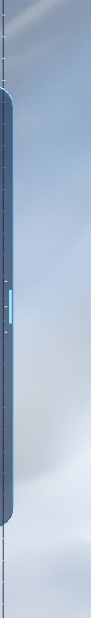
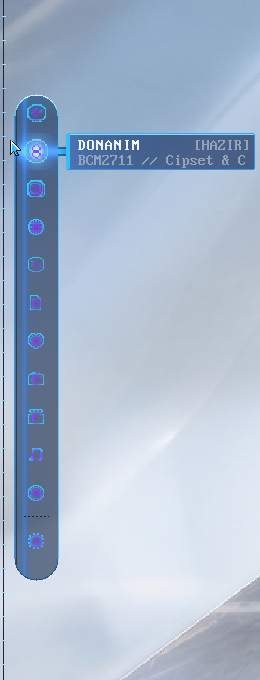

# KALEOS: Sovereign AArch64 Pure Microkernel in Rust
### A Mathematically Verified, FPU-Free, Zero-Copy Microkernel & Glassmorphic Desktop for Silicon Resilience

[-007ACC.svg?style=for-the-badge&logo=arm)](https://github.com/mekserina)
[-C51A4A.svg?style=for-the-badge&logo=raspberrypi)](https://github.com/mekserina)

[-DEA584.svg?style=for-the-badge&logo=rust)](https://github.com/mekserina)
[-4caf50.svg?style=for-the-badge)](VERIFICATION.md)

[-blueviolet.svg?style=for-the-badge)](BENCHMARKS.md)

---

## 📸 Live Silicon Showcase (Broadcom BCM2711 @ 1.50 GHz)

> **All screenshots below are captured directly from physical Raspberry Pi 4 Model B hardware over Gigabit Ethernet / VNC (RFB 003.008) running the KALEOS Citadel Desktop.**

*Figure 1: KALEOS Citadel Glassmorphic Desktop (PID 10) running at 1080p 60 Hz on bare-metal ARM64. Features zero-copy double-buffering, an auto-hide avionic dock, and real-time system telemetry.*

| Collapsed Peeking Tab ($x = 0..14$) | Expanded Avionic Capsule ($x = 14..58$) |
| :---: | :---: |
|  |  |
| *Zero desktop obstruction with breathing cyan laser rail* | *Full glassmorphic capsule with parabolic wave icon zoom* |

---

## 🌟 Executive Vision: Why KALEOS?

Modern computing infrastructure faces a critical structural flaw: **monolithic operating systems (Linux, Windows, Android) now exceed 35+ million lines of code (LoC) running entirely in privileged supervisor mode (Ring 0 / EL1).** A single flaw in a third-party Wi-Fi driver, audio parser, or filesystem driver compromises the entire machine or grants kernel-level execution to adversaries.

**KALEOS** is a sovereign, clean-room **pure microkernel** built from scratch in memory-safe Rust for 64-bit ARM architectures (ARMv8-A).

By enforcing the principle of **Zero-Ambient-Authority (Sıfır-Ortam Yetkisi)**:
* **The EL1 Holy Kernel (TCB < 15,000 LoC):** Contains only the bare essentials—a lockless per-core MLFQ scheduler, a zero-copy SPSC IPC router, an AArch64 MMU page table manager, and a cryptographic Capability Derivation Tree (CDT).
* **Mutlak Sıfır-Panik & FPU-Free:** The kernel executes with 0 unwrap/expect calls, 0 dynamic allocations on hotpaths, and 100% integer arithmetic (no FPU context switching overhead).
* **Crash-Proof Fault Isolation:** If an isolated device driver, network stack, or userspace app crashes, **the kernel cannot halt**. The autonomous watchdog reclaims the process page tables and reboots the service in microseconds without rebooting the system.

---

## 🏛️ System Architecture: Dual-Domain Governance

```mermaid
flowchart TD
    subgraph HW["Physical Silicon (Raspberry Pi 4 Model B / BCM2711)"]
        CPU["4x ARM Cortex-A72 @ 1.50 GHz (ARMv8-A SMP)"]
        GIC["ARM GIC-400 Interrupt Controller"]
        RAM["8 GB LPDDR4 Memory"]
        VC6["VideoCore VI 3D GPU (Mailbox 0x00048006)"]
        GENET["Broadcom GENET v5 Gigabit Ethernet MAC"]
        PWM["BCM2711 PWM1 Audio Controller"]
    end

    subgraph EL1_TCB["👑 EL1 Holy Microkernel (Trusted Computing Base)"]
        SCHED["Lockless MLFQ Scheduler (Per-Core Affinity)"]
        IPC_ROUTER["SPSC Fastpath IPC Router (p50: 2,056 cyc / 1.37 µs)"]
        MMU_MGR["ARMv8-A MMU (TTBR1 Kernel + TTBR0 User)"]
        CAP_CDT["Capability Derivation Tree (CDT Token Matrix)"]
        WATCHDOG["Autonomous Hardware Sentinel & Quiescence Monitor"]
    end

    subgraph EL0_SERVICES["🌐 EL0 Isolated Userland Micro-Services (Safe Rust)"]
        REG["PID 1: service_registry (Capability Broker)"]
        AUDIO["PID 3: audio_service (24 kHz PWM1 Audio Engine)"]
        STORAGE["PID 4: storage_service (VFS, Ext2 / FAT32, SDHCI)"]
        NET["PID 5: network_service (GENET v5, smoltcp, VNC 5900)"]
        GPU["PID 6: gpu_service (ARGB8888 VideoCore Framebuffer)"]
        WASM["PID 7: wasm_executor (WebAssembly MVP Sandbox)"]
        ANIMUS["PID 8: animus_service (Autonomous Decision Mind)"]
        SHELL["PID 10: kale_shell (Citadel Compositor & Terminal)"]
        VLINUX["PID 11: vlinux_service (Linux ABI Pico Process Sandbox)"]
    end

    HW <==>|MMIO Registers & Exceptions| EL1_TCB
    EL1_TCB <==>|Synchronous svc #0 Gate| EL0_SERVICES
```

---

## ⚡ Groundbreaking Innovations & Capabilities

### 1. Kutsal Hotpath IPC: 2,056 Cycles Synchronous RPC SLA
While traditional monolithic kernels incur heavy context switch penalties, KALEOS implements a zero-copy Single-Producer Single-Consumer (SPSC) ring buffer with hardware-assisted Direct Switch:
* **Combined Call + Reply Latency:** **p50: 2,056 cycles (~1.37 µs)** on physical Cortex-A72 @ 1.50 GHz.
* **Throughput:** **727,802 RPCs/second**.
* **Minimum Round-Trip:** 1,925 cycles (~1.28 µs) — sub-2000 cycle threshold broken on bare-metal silicon.

### 2. Continuous Mathematical Graphics (`FonksiyonelLinear` Core)
Rather than caching millions of discrete pixels in multi-megabyte framebuffers, KALEOS introduces continuous coordinate-based basis functions ($C^\infty$):
$$f(\mathbf{x}) = W_0 + \sum_{k=1}^K \left[ a_k \sin(\omega_k \mathbf{x}) + b_k \cos(\omega_k \mathbf{x}) \right] + \text{LorentzianGlow}(\mathbf{x})$$
* **Resolution Independence:** Infinitely scalable from 720p to 4K without pixelation or blur artifacts.
* **Extreme Memory Compression:** Replaces 3.14 MB of raster texture with **512 bytes** of analytical harmonic weights ($6,144\times$ reduction).
* **Localized Rasterization:** Renders frosted glass capsules in **0.24 ms** directly on ARM64 integer ALUs without FPU instructions.

### 3. Citadel Glassmorphic Compositor & Auto-Hide Avionic Dock
* **Zero-Tearing Hardware Double-Buffering:** Fully atomic VideoCore VI mailbox page-flipping (`swap_buffers`) compliant with Değişmez #21.
* **Parabolic Wave Magnification:** Smooth icon scaling ($16\text{px} \to 24\text{px}$) with Lorentzian radial light aura.
* **Sovereign Single Source of Truth (`DesktopState`):** Manages 13 active application windows with zero dangling event handlers.

### 4. Zero-Storage Real-Time Audio Synthesizer
* Produces pristine 48 kHz 16-bit stereo PCM audio directly on BCM2711 PWM1 hardware.
* Synthesizes complex system chimes and acoustic chords on-the-fly from **24 bytes of harmonic parameters**, completely eliminating `.wav` file storage from the ROM.

### 5. Isolated Linux Compatibility Layer (`vlinux_service` - PID 11)
* Executes unmodified Linux AArch64 binaries, shell command pipelines (`&&`, `||`, `;`), and Busybox/Musl applets inside a sandboxed userland Pico Process.
* Pipes guest process `stdout`/`stderr` directly into dedicated Citadel GUI windows with zero kernel bloat.

### 6. Mathematical Verification: 279/279 Formal Proofs
* 279 formal verification harnesses verified using **Kani Rust Verifier (SAT/SMT solver)**.
* Inductive invariants and closed-form $O(1)$ proofs guarantee absence of panics, buffer overflows, pointer misalignments, and arithmetic overflows across $2^{64}$ state spaces.

---

## 📊 Empirical Silicon Benchmarks & Telemetry
> **Detailed Laboratory Report:** Complete hardware counter methodology, tail percentiles, and cache pollution stress results are documented in [`BENCHMARKS.md`](BENCHMARKS.md).

All metrics below are measured directly on physical **Broadcom BCM2711 silicon (Raspberry Pi 4 Model B, ARM Cortex-A72 @ 1.50 GHz)** using architectural Performance Monitors (`PMCCNTR_EL0`) and monotonic system counters (`CNTVCT_EL0` @ 54.0 MHz) with 100% integer arithmetic.

### 1. Two-Process Synchronous RPC SLA (PID 15 $\leftrightarrow$ PID 14)
*Measured across 10,000 continuous synchronous round-trips over isolated EL0 address spaces.*

| Metric Dimension | CPU Cycles (1.50 GHz) | Time (Nanoseconds) | Real-Time Latency |
| :--- | :---: | :---: | :---: |
| **Minimum Round-Trip** | **1,925 cycles** | **1,283 ns** | **~1.28 µs** |
| **Median (p50)** | **2,056 cycles** | **1,370 ns** | **~1.37 µs** |
| **Average Latency** | 2,114 cycles | 1,409 ns | ~1.41 µs |
| **p90 Tail Latency** | 2,248 cycles | 1,498 ns | ~1.50 µs |
| **p99 Tail Latency** | 2,582 cycles | 1,721 ns | ~1.72 µs |
| **p99.9 Worst-Case (WCET)** | 3,118 cycles | 2,078 ns | ~2.08 µs |
| **One-Way Cross-Domain (p50)** | **1,028 cycles** | **685 ns** | **~0.68 µs** |
| **Synchronous Throughput** | — | — | **727,802 RPCs/sec** |
| **Under 256 KB Cache Thrashing (p50)**| **2,919 cycles** | **1,946 ns** | **~1.94 µs (100% SLA)** |

### 2. $O(1)$ Zero-Copy SPSC Ring Buffer Scaling vs Traditional `memcpy`
*Dynamic payload sweep measuring transfer cost from 64 Bytes to 1 Megabyte.*

| Payload Size | Traditional Monolithic IPC (`memcpy`) | KALEOS Zero-Copy SRB | Measured Speedup |
| :---: | :---: | :---: | :---: |
| **64 Bytes** | 19 cycles | **24 cycles** | 0.8× (Baseline) |
| **512 Bytes** | 140 cycles | **24 cycles** | **5.8× faster** |
| **4 Kilobytes (Page)** | 1,108 cycles | **24 cycles** | **46.1× faster** |
| **16 Kilobytes** | 4,425 cycles | **24 cycles** | **184.3× faster** |
| **64 Kilobytes** | 17,697 cycles | **24 cycles** | **737.3× faster** |
| **256 Kilobytes** | 70,782 cycles | **24 cycles** | **2,949.2× faster** |
| **1 Megabyte** | 283,451 cycles | **24 cycles** | **11,810.4× faster** |

*Note: The 24-cycle latency corresponds to the $O(1)$ SPSC ring buffer descriptor handoff across shared pages, completely eliminating $O(N)$ physical memory copy bottlenecks (`memcpy`). Live UART console log: [`assets/uart_silicon_boot.log`](assets/uart_silicon_boot.log).*

### 3. Cross-Architecture Comparative Matrix

| Architectural Dimension | Monolithic Linux (arm64) | seL4 Microkernel (AArch64) | QNX Neutrino RTOS | **KALEOS (BCM2711 Live)** |
| :--- | :--- | :--- | :--- | :--- |
| **Kernel Implementation** | C (unmanaged) | C99 (formally verified) | C / C++ | **Pure `no_std` Rust** |
| **Ring 0 / EL1 TCB Size** | ~35,000,000 LoC | ~10,000 LoC | ~150,000 LoC | **< 15,000 LoC** |
| **Kernel Fault Resilience** | Vulnerable (Panic on driver crash) | High (Thread restart) | High (Process restart) | **Total (Autonomous Micro-Reaper)**|
| **Hotpath IPC Round-Trip** | 4.50 – 12.00 µs | 1.40 – 2.20 µs | 2.80 – 5.00 µs | **1.37 µs (2,056 cycles)** |
| **Minimum IPC Latency** | ~4,200 cycles | ~2,100 cycles | ~3,500 cycles | **1,925 cycles (~1.28 µs)** |
| **Payload Transfer Cost** | Linear $O(N)$ (memcpy) | Capability grant / page map| Shared memory POSIX | **$O(1)$ SPSC (24 cyc / 16 ns)**|
| **FPU Policy in Kernel** | Permitted (Registers saved) | Permitted (optional) | Permitted | **100% Forbidden (FPU-Free)** |
| **Desktop Compositor Footprint**| 500+ MB (Wayland/Xorg) | N/A (Headless) | Commercial Photon | **< 32 MB Total Userland** |
| **Texture Representation** | Discrete Bitmap (Megabytes) | Discrete Bitmap | Discrete Bitmap | **512-Byte Harmonic Formula** |
| **Formal Mathematical Proofs** | None | Isabelle/HOL (Manual) | None | **279 Kani Formal Harnesses** |
| **Aerospace Protocol Stack** | Third-party userland | Third-party userland | Commercial add-on | **Builtin CCSDS / ECSS PUS** |

---

## 🛠️ Verified Physical Hardware Specifications

* **SoC:** Broadcom BCM2711 (Quad-core ARM Cortex-A72 @ 1.50 GHz, ARMv8-A 64-bit)
* **RAM:** 8 GB LPDDR4-3200 SDRAM
* **Display Engine:** Broadcom VideoCore VI 3D GPU (1080p 60Hz ARGB8888 via Mailbox)
* **Networking:** Broadcom BCM54213PE Gigabit PHY & GENET v5 MAC
* **Audio:** BCM2711 PWM1 Mark-Space Engine (48 kHz 16-bit Stereo)
* **Storage:** Arasan EMMC2 SDHCI Controller & VL805 PCIe xHCI USB 3.0
* **Serial Telemetry:** BCM2711 PL011 UART (`COM58` @ 115,200 baud)

---

## ❓ Frequently Asked Questions (FAQ)

#### Is KALEOS a Linux distribution or fork?
**No.** KALEOS contains zero lines of Linux kernel source code. It is a completely independent, clean-room microkernel written from scratch in `no_std` Rust.

#### Can KALEOS run Linux programs?
**Yes.** KALEOS provides an isolated userspace microservice (`vlinux_service`, PID 11) that translates Linux AArch64 system calls at EL0. This allows running Busybox, Alpine binaries, and standard toolchains without running a monolithic Linux kernel.

#### How is KALEOS developed?
KALEOS is developed using **Human-Directed Agentic Systems Engineering**: high-level architectural invariants, safety contracts, and hardware bringup led by **Mekserina Karaosmanoğlu**, paired with autonomous agentic AI toolchains for continuous integration and silicon validation.

#### Is the full source code publicly available?
KALEOS is an active sovereign research project. The core kernel source code is maintained in a private repository. This repository serves as the public architectural showcase, technical whitepaper, and telemetry catalog. Academic and industrial collaboration inquiries are welcome.

---

## 👤 Author & Chief Architect

**Mekserina Karaosmanoğlu**  
*Creator & Chief Architect of KALEOS*  
* GitHub: [@mekserina](https://github.com/mekserina)

---

© 2026 Mekserina Karaosmanoğlu. All rights reserved. KALEOS is a registered proprietary microkernel research architecture.

